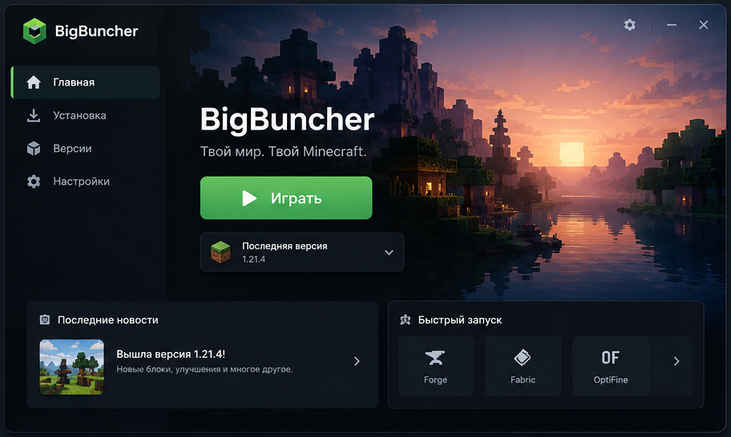

# BigBuncher

Лаунчер Minecraft: Java Edition для Windows. Electron + React + TypeScript.

[English version](README.en.md)



## Возможности

- Запуск Minecraft Java Edition любой версии (релизы и снапшоты из манифеста Mojang).
- Установка версий и автоматическая установка загрузчиков **Forge, Fabric, NeoForge, Quilt**.
- Сборки (инстансы): у каждой своя папка с модами, мирами и конфигами; версии, библиотеки и ассеты общие.
- Каталог модов **Modrinth** (без ключа) и **CurseForge** (нужен бесплатный API-ключ) с поиском, установкой обязательных зависимостей, включением/выключением и удалением.
- Вкладка «Скины»: библиотека, загрузка PNG, копирование по нику, экспорт и редактор с двумя режимами:
  **Тело** (рисование прямо на 3D-модели) и **Текстура** (развёртка). Слои каждой части тела и оверлея скрываются
  панелью слева сверху; кисть, пипетка, спрей, заливка, дизеринг, затемнение/осветление/инверсия, замена цвета,
  ластик, симметрия, сетка, масштаб, палитра с импортом/экспортом.
- **Мультисборки**: несколько состояний одной сборки (копия с другими модами или другая версия), переключение в один клик.
- **Текстурпаки**: общие для всех сборок (с автовключением даже на «чужой» версии) и свои у каждой сборки.
- **Автообновление** через GitHub Releases: лаунчер сам предлагает новую версию.
- **Доктор крашей** (1.2): после вылета читает `latest.log`, краш-репорт и `hs_err`, объясняет причину простыми словами
  и чинит в один клик с перезапуском игры. Умеет: доставить недостающий мод с Modrinth, обновить или выключить
  виновника (включая поиск мода по стектрейсу и ошибкам миксинов), прибавить RAM, вернуть авто-Java, сбросить битый
  конфиг (в корзину), переключить Vulkan → OpenGL, починить файлы игры. Следит за входом на сервер: другая версия,
  офлайн-аккаунт на лицензионном сервере, несовпадение модов. Проверка модов **до запуска** (дубли, не тот загрузчик,
  нет зависимости) и **автопоиск сломанного мода** делением пополам, если по логам причину не понять.
- **Vulkan / OpenGL** для Minecraft 26.2+: лаунчер спрашивает при первом запуске (или «Не знаю — определи сам»:
  проверяет драйвер Vulkan и видеокарту) и передаёт игре `--graphicsBackend`.
- **Режим разработчика модов** (включается в настройках): привязка Gradle-проекта к сборке, «Собрать и запустить»,
  автокопирование нового jar из `build/libs`, отладчик JDWP (порт 5005, HotSwap), экспорт и подробный лог миксинов,
  запуск сразу в мир/на сервер (quick play), консоль с фильтрами и кнопкой «Разобрать ошибку», инспектор модов.
- 3D-модель игрока со скином на главном экране.
- Скин применяется **в самой игре даже без входа в Microsoft**: лаунчер поднимает локальный Yggdrasil-сервер и подключает `authlib-injector`. Для Microsoft-аккаунтов скин загружается в профиль Mojang.
- Вход через Microsoft (Xbox Live → Minecraft Services) и офлайн-режим.
- Автоматическая загрузка нужной Java (официальные рантаймы Mojang) или своя Java.
- Настройки RAM, Java, папки игры, разрешения, JVM-аргументов. Всё сохраняется.

## Готовый exe

`release/BigBuncher.exe` (portable: один файл, установка не нужна). Копия лежит в корне: `BigBuncher.exe`.

Данные:
- настройки, аккаунты, скины: `%APPDATA%\BigBuncher\`
- игра (версии, библиотеки, Java, сборки): `%APPDATA%\.bigbuncher\` (меняется в настройках)

## Разработка

Требования: Node.js 20+ (проверено на 24), Windows 10/11. Python 3 + Pillow нужен только для пересборки картинок.

```bash
npm install          # зависимости
npm run dev          # запуск с hot reload
npm run typecheck    # проверка типов
npm run build        # сборка в out/
npm run dist         # сборка release/BigBuncher.exe
npm run assets       # пересобрать картинки из assets/ (py -3 scripts/prepare_assets.py)
```

### Выпуск обновления

1. Поднять `version` в package.json (например 1.1.0 → 1.2.0).
2. `npm run release` — соберёт exe и выложит его в github.com/ahmaPley/BigBuncher/releases.
   Токен берётся из `%USERPROFILE%\.secrets\github_token.txt` и не выводится.
3. У всех, у кого BigBuncher 1.1.0+, появится кнопка «Обновить».

### Проверки

Сквозной смоук-тест (реальные загрузки и запуск игры, временная папка настроек):

```bash
npm run build
BIGBUNCHER_SMOKE=1 BIGBUNCHER_SMOKE_LOADERS=fabric,forge,neoforge,quilt BIGBUNCHER_SMOKE_LAUNCH=fabric npx electron .
```

Проверка мультисборок, текстурпаков и обновлений (без запуска игры):

```bash
BIGBUNCHER_SMOKE=features npx electron .
```

Доктор крашей: разбор известных ошибок + настоящая сборка Fabric с модом без Fabric API (проверка до запуска → краш →
исправление в один клик → игра доходит до меню):

```bash
BIGBUNCHER_SMOKE=doctor npx electron .
```

Запись трейлера (демо-данные во временной папке, ffmpeg пишет окно): `BIGBUNCHER_TRAILER=<папка> npx electron .`

Скриншот любой страницы без ручного кликанья (`#skins/new` открывает редактор; `BIGBUNCHER_CAPTURE_CLICKS="x,y;x,y"` — клики в DIP перед снимком):

```bash
BIGBUNCHER_PAGE=skins BIGBUNCHER_CAPTURE=shot.png npx electron .
```

## Документация

- [ARCHITECTURE.md](ARCHITECTURE.md) — структура и взаимодействие модулей.
- [AGENTS.md](AGENTS.md) — правила для ИИ-агентов и разработчиков.
